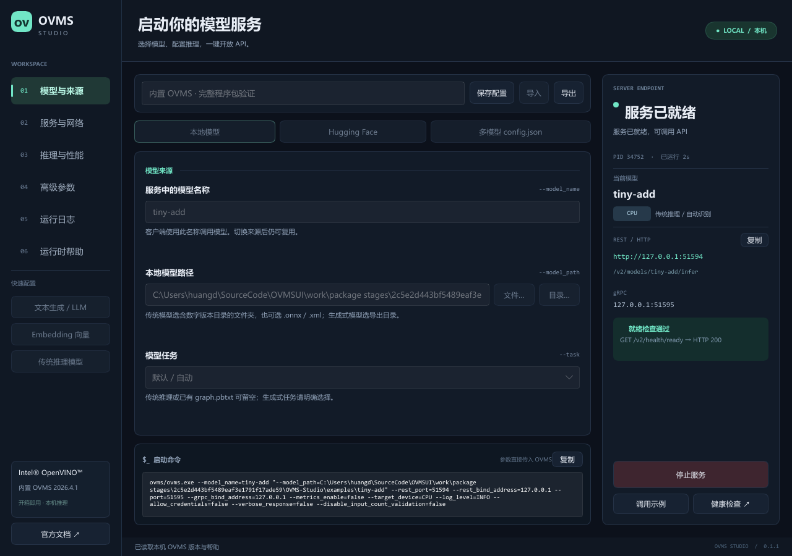

# OVMS Studio

[](https://github.com/toponehhh/OVMStudio/actions/workflows/release.yml)

[下载完整 Windows 一体包](https://github.com/toponehhh/OVMStudio/releases/latest) · [自动发布说明](docs/releases.md)

用 **Rust + Slint** 编写的 Intel OpenVINO Model Server 桌面应用，中文界面，原生进程管理。**0.1.1 起随 UI 一起内置 OVMS 2026.4.1 和 Python 运行时**，无需指定 OVMS 路径或另外安装 Python。启动参数已核对官方文档、对应发布标签的 C++ 解析器和官方程序的 `--help`。



## 使用

1. 从 [Releases](https://github.com/toponehhh/OVMStudio/releases/latest) 下载完整 Windows ZIP 并解压，打开 `OVMS-Studio/OVMS-Studio.exe`。本地构建文件位于 `dist/`。
2. 在「模型与来源」选择本地模型、Hugging Face 或已有多模型 `config.json`。
3. 在「推理与性能」选择 CPU / GPU / NPU 等设备，按任务调整参数；在「服务与网络」设置端口。
4. 点击「启动服务」。出现「服务已就绪」代表 `/v2/health/ready` 实际返回 HTTP 200。可复制 Endpoint、调用示例，或打开健康检查。

移动应用时保留整个 `OVMS-Studio` 文件夹。发布版固定使用 `OVMS-Studio.exe` 旁的 `ovms/ovms.exe`，自动配置随包提供的 Python 和 DLL 环境，不依赖系统 PATH、`OVMS_HOME` 或旧配置中的运行时路径。内置文件缺失时会提示重新解压完整程序包。

首次启动默认监听本机 `127.0.0.1`，REST 为 `8000`，gRPC 为 `9000`。设置端口为 `0` 可关闭相应协议。需要局域网访问时，将监听地址改为 `0.0.0.0`。GPU / NPU 是否可用取决于本机驱动、OVMS 构建和模型支持；界面不会把设备名称当作硬件检测结果。

### 选择模型

| 来源 | 需要填写 | 行为 |
|---|---|---|
| 本地传统模型 | 模型名称、模型路径 | 选择含 `1/`、`2/` 等版本目录的仓库，也可选择 OVMS 支持的单个 `.onnx`、`.xml` 等文件 |
| 本地生成式模型 | 名称、导出目录、任务 | 可选 `text_generation`、`embeddings`、`rerank`、`image_generation`、`text2speech`、`speech2text` |
| Hugging Face | 仓库 ID、模型名称、下载目录、任务 | 使用 `--source_model` 下载并启动；不会传入仅下载用的 `--pull` |
| 多模型配置 | 已有 `config.json` | 模型路径、设备和推理设置由 JSON 中的各模型定义；界面只传服务器通用参数 |

LLM / Embedding / 传统推理模板只设置任务，保留你选择的路径。所有非必填参数留空时沿用 OVMS 默认值。传统模型 `shape` 优先于 `batch_size`。HF 的 `OpenVINO/...` 已导出模型不能设置导出权重精度；需要 Optimum 转换的原始模型可设置。

内置的是官方 `python_on` 包，完整保留 OVMS 的 DLL、Python、许可证和第三方许可证目录。其环境只对 OVMS 子进程生效，不修改系统 PATH。GPU / NPU 仍需相应设备驱动；模型文件由用户选择或下载。自定义环境变量可在高级参数中填写 JSON 对象；该对象会明文保存，HF 令牌建议使用系统 `HF_TOKEN`。程序不管理 Docker、WSL 或远程 SSH。

系统级 Microsoft Visual C++ x64 运行库要求沿用官方 OVMS Windows 说明；本机已具备该运行环境并通过验证。

### 日志、保存与停止

- 可命名保存多个配置，快速切换，导入 / 导出独立 JSON。最后一份配置会自动保存在系统用户配置目录：Windows 通常为 `%APPDATA%\OVMSStudio\OVMS Studio\config\profiles.json`，实际位置由 `directories` 的平台规则确定。
- 导入配置中的相对文件路径以导入文件所在目录解析。界面中手工填写的相对模型、缓存和日志路径默认以 UI 所在目录为准；可在高级参数中设置「相对路径基准目录」。旧配置中的 `executable` 字段会自动忽略并移除。
- 启动参数逐项传给 `Command`，不经过 Shell。高级扩展参数使用 JSON 字符串数组，不允许重复设置已有参数或切换到 `--pull`、`--configure` 等一次性命令。
- stdout / stderr 在后台持续读取；界面保留最近 1,000 行，日志突发时采用有界队列，避免堵塞 OVMS。可复制、导出或清空显示。
- Windows 使用 Job Object 管理 OVMS 及子进程，停止或关闭界面会终止进程组。**停止是强制终止，正在执行的推理会中断**。程序不安装系统服务，也不让服务在退出后留在后台。
- 仅启用 gRPC 时会显示「进程运行中，未验证模型就绪」。界面没有把 TCP 连接成功或进程存在当作模型加载成功。

## 零依赖验证模型

项目包含 `examples/tiny-add/1/model.onnx`，输入 `input` 为 FP32 `[1,3]`，模型计算 `output = input + input`。可由 Python 标准库重新生成：

```powershell
python scripts/create_demo_model.py
```

导入程序包中的 `examples/demo-profile.json` 后直接启动，无需设置运行时。推理请求：

```powershell
$body = '{"inputs":[{"name":"input","shape":[1,3],"datatype":"FP32","data":[1,2,3]}]}'
Invoke-RestMethod -Uri 'http://127.0.0.1:8000/v2/models/tiny-add/infer' -Method Post -ContentType 'application/json' -Body $body
```

预期 `outputs[0].data` 为 `[2,4,6]`。`examples/multi-model-config.json` 可验证多模型配置模式。

## 构建

需要 Rust **1.92+**。Slint 固定为 `1.18.1`，使用 Winit + software renderer，无需 Qt 或 Skia。

Windows 常规构建：安装 Visual Studio C++ Build Tools，在开发者终端执行：

```powershell
cargo build --locked --release
cargo test --locked
cargo clippy --locked --all-targets -- -D warnings
```

本机验证采用独立的 GNU Rust 工具链和项目内的便携 LLVM-MinGW，没有修改系统默认 Rust 工具链。已准备好工具的本工作目录可执行：

```powershell
python scripts/fetch-runtime.py
./scripts/build-local.ps1
./scripts/build-local.ps1 -Test
./scripts/build-local.ps1 -Clippy
./scripts/build-local.ps1 -RealTest
./scripts/build-local.ps1 -Release
./scripts/package.ps1
```

便携构建路径见 `scripts/env-local.ps1`：Rust `1.99.1-x86_64-pc-windows-gnu`、LLVM-MinGW `20261020`、Cargo 缓存 `work/cargo-home`。LLVM-MinGW 的库搜索还需要 Rust 自带的 `lib/self-contained`，以提供 GNU unwinding 库。该脚本服务于当前验证环境，不要求其他开发者使用相同目录。

打包脚本始终包含完整 OVMS 运行时，并生成带 CRC 检查和 SHA-256 的 ZIP；运行时未准备完整时打包失败。`python scripts/fetch-runtime.py` 下载固定版本并核对官方 SHA-256。开发构建可使用 `work/runtime-python-on` 中的暂存运行时，发布构建没有开发目录回退逻辑。

当前一体包和实际运行验证覆盖 Windows x64。Linux 构建需自行提供对应平台的 OVMS 包和系统开发依赖。

## 验证

本次实际构建、测试范围和发布文件校验值见 [Windows 本机验证记录](docs/verification.md)。

纯契约测试覆盖模式互斥、参数类型、布尔值、端口 / 指标关系、任务切换、版本策略、扩展参数、环境变量和健康检查。

真实运行时测试需要 OVMS 和示例模型，默认不会在 `cargo test` 中启动服务：

```powershell
$env:OVMS_TEST_BUNDLE = 'C:\path\to\OVMS-Studio'
cargo test --test real_ovms -- --ignored --test-threads=1
```

覆盖真实模型加载 / 推理、停止 / 重启 / 回收、占用端口拒绝、多模型 JSON、无效模型失败和本机帮助参数。UI 验证模式通过同一套界面回调执行启动、停止、重启和关闭，并导出六个页面的真实渲染截图：

```powershell
./dist/OVMS-Studio/OVMS-Studio.exe --profile examples/demo-profile.json --smoke-test --capture-dir work/ui-smoke
```

`--profile <file>` 打开指定配置；`--no-persist` 禁用读取 / 写入用户配置，适合验证。测试模式自动禁用用户配置读写。GPU / NPU、HF 实际下载、完整生成式推理和 Linux 运行仍需要对应硬件、网络及模型另行验证。

## 源码

| 文件 | 内容 |
|---|---|
| `ui/app.slint` | 原生桌面界面，参数表单、服务状态、日志与帮助 |
| `src/config.rs` | 参数目录、任务作用域、配置序列化、规则校验和命令生成 |
| `src/runtime.rs` | 内置 OVMS 定位、路径检查、子进程环境、运行时帮助和 HTTP 就绪探测 |
| `src/process.rs` | 后台进程监督、日志管道、生命周期及 Windows Job Object |
| `src/main.rs` | 界面交互、配置库、文件对话框、剪贴板和 UI 验证模式 |
| `docs/parameters.md` | 启动参数研究、来源、默认值和版本差异 |

此项目为独立启动器。官方来源：[参数文档](https://docs.openvino.ai/2026/model-server/ovms_docs_parameters.html)、[2026.4.1 发布](https://github.com/openvinotoolkit/model_server/releases/tag/v2026.4.1)、[该版本参数解析源码](https://github.com/openvinotoolkit/model_server/blob/v2026.4.1/src/cli_parser.cpp)。
