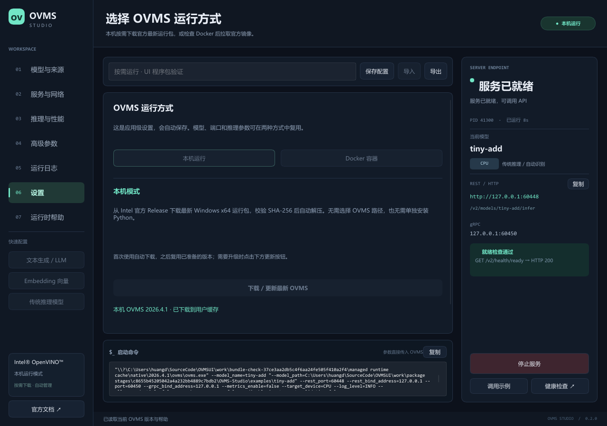

# OVMS Studio 0.2.0 验证说明

2026-11-03 本机 Windows x64 验证：

- Rust Clippy 通过，16 项参数契约、8 项部署/安装测试及 6 项真实 OVMS 测试通过。
- 12 项发布脚本测试通过，包含纯 UI 归档创建、拒绝误打包运行时、草稿查询和发布顺序。
- 使用不含 OVMS 的 UI 程序包、精简 PATH、独立工作目录和空缓存，实际下载官方最新稳定 OVMS 2026.4.1。
- 真实推理输入 `[1,2,3]`，输出 `[2,4,6]`；UI 就绪、停止、重启及退出回收通过。
- 下载后的 Python 可用；阻断外部代理后复用缓存仍可启动，强制检查更新则正确报网络错误。
- 未安装 Docker 的本机诊断正确，在镜像下载前给出安装提示。

本机未安装 Docker。真实 Docker CPU 测试由 GitHub Actions 的独立 Linux job 执行，正式发布同时要求 Windows 与 Docker job 成功。

[当前 Actions](https://github.com/toponehhh/OVMStudio/actions/workflows/release.yml) · [Releases](https://github.com/toponehhh/OVMStudio/releases)

每个 Release 中的本文件由该次 CI 实际证据重新生成，包含准确提交、运行链接与可执行文件哈希；本源码文档不代替线上运行结果。

GPU/NPU 镜像选择及设备映射已做参数契约测试，实体加速器未验证；真实大模型下载、生成式推理及 Linux 桌面 UI 未在本机验证。

